<div align="center">


Put your localhost on a public HTTPS link with one command.

[](https://github.com/muhammad-deve/GoPort/releases/latest)
[](LICENSE)



</div>

GoPort is an open-source tunnel, similar to ngrok. Run `goport http 8080` and the app on port 8080 becomes reachable at a link like `https://abc123.goport.uz`. You don't need a public IP, port forwarding or any router settings.

It's handy when you want to show someone a site that only runs on your machine, test webhooks from Telegram, payment providers or GitHub against local code, or open a local API from your phone.

## Download

<p align="center">
  <a href="https://github.com/muhammad-deve/GoPort/releases/latest/download/goport-windows-setup.exe"></a>
  <a href="https://github.com/muhammad-deve/GoPort/releases/latest/download/goport-darwin-arm64"></a>
  <a href="https://github.com/muhammad-deve/GoPort/releases/latest/download/goport-darwin-amd64"></a>
  <a href="https://github.com/muhammad-deve/GoPort/releases/latest/download/goport-linux-amd64"></a>
</p>

Every button downloads the latest release. The Windows installer adds `goport` to your PATH and doesn't need admin rights. On macOS and Linux you get the program file itself, which needs one more step (see below), so Homebrew is the easier route on a Mac.

## Getting started

### 1. Install

**macOS** with Homebrew:

```bash
brew install muhammad-deve/goport/goport
```

**Windows:** run the installer from the button above, or use Chocolatey or Scoop:

```
choco install goport
```

```
scoop bucket add goport https://github.com/muhammad-deve/scoop-goport
scoop install goport
```

**Linux:**

```bash
sudo curl -fsSL -o /usr/local/bin/goport \
  https://github.com/muhammad-deve/GoPort/releases/latest/download/goport-linux-amd64
sudo chmod +x /usr/local/bin/goport
```

If you used a download button on macOS or Linux, make the file runnable and move it onto your PATH. Use the name of the file you got, for example on an Apple Silicon Mac:

```bash
cd ~/Downloads
chmod +x goport-darwin-arm64
xattr -c goport-darwin-arm64    # macOS only: clears the download quarantine
sudo mv goport-darwin-arm64 /usr/local/bin/goport
```

Check that it worked:

```bash
goport --version
```

### 2. Connect your account

Sign up at [goport.uz](https://goport.uz/signup), then copy your token from the [Tokens](https://goport.uz/dashboard#tokens) page of the dashboard:

```bash
goport auth <token>
```

The token is saved on your machine, so you only do this once.

### 3. Start a tunnel

```bash
goport http 8080
```

Use whatever port your app runs on. GoPort prints the public link and logs each request as it comes in. Press `Ctrl+C` to stop.

## Everyday use

**Your link stays the same.** `goport http` reuses your last subdomain, so you can restart it without sending people a new link.

**Get a new random link:**

```bash
goport http 8080 --reset
```

**Pick your own name** (Pro):

```bash
goport http 8080 --custom myapp    # https://myapp.goport.uz
```

`-n myapp` does the same thing.

**Look at the traffic.** While a tunnel is running, open <http://127.0.0.1:4040>. You can see every request and response, replay a request, or copy it as a cURL command.

**Dropped connections.** If your Wi-Fi drops or your laptop goes to sleep, GoPort reconnects by itself and keeps the same link (since 0.1.8).

**WebSockets** work too, so things like Next.js hot reload behave normally through the tunnel.

## How it works

<p align="center">
  
</p>

The CLI connects out to the server and keeps that one connection open. When a request arrives for your subdomain, the server opens a new stream on that connection using [yamux](https://github.com/hashicorp/yamux), and the CLI hands it to your local port and sends the response back the same way.

Because your machine makes the connection, it works behind NAT and firewalls with no setup. The original `Host` header is kept, so apps that build links from it (Swagger UI, redirects, host-based routing) behave the same as in production.

## Configuration

These environment variables are optional:

| Variable             | What it does                                                          |
|----------------------|-----------------------------------------------------------------------|
| `GOPORT_TOKEN`       | Use this token instead of the one saved by `goport auth`, e.g. in CI |
| `GOPORT_SERVER_ADDR` | Tunnel server address. Default: `goport.uz:7000`                      |
| `GOPORT_DOMAIN`      | Domain for public links. Default: `goport.uz`                         |
| `GOPORT_API_URL`     | API address. Default: `https://back.goport.uz`                        |

To run your own server, see [goport.uz/self-hosting](https://goport.uz/self-hosting).

## What's in this repo

| Folder        | Contents                                                     |
|---------------|--------------------------------------------------------------|
| `server/`     | The `goport` CLI, written in Go (despite the folder name)    |
| `backend/`    | The tunnel server and API, built on PocketBase               |
| `landing/`    | goport.uz and the account dashboard (Next.js)                |
| `Installers/` | Windows installer, Homebrew, Scoop and Chocolatey packages   |

Each folder is its own repository, added as a submodule. To build the CLI from source:

```bash
git clone --recursive https://github.com/muhammad-deve/GoPort.git
cd GoPort/server
go build -o goport .
```

## Contributing

Bug reports and pull requests are welcome. If something breaks, [open an issue](https://github.com/muhammad-deve/GoPort/issues) with the command you ran, your OS, the output of `goport --version`, and the error you saw.

## License

[MIT](LICENSE)
